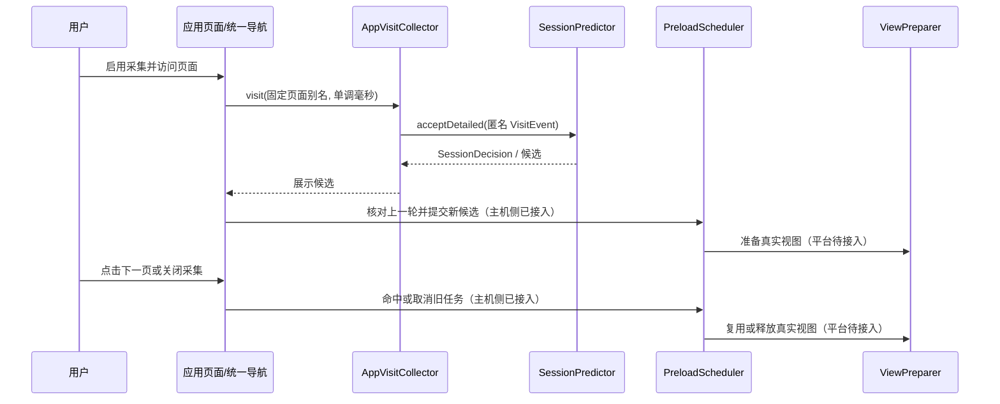

# A 部分工程流程：应用、行为采集与集成

本文件记录 A 的实施顺序、接口边界和验收证据。依据仓库 `README.md` 分工、`src/contracts.ts` 契约和 P07 要求；目前主机侧测试与 ArkTS 编译通过，尚未证明 OpenHarmony 应用在设备上运行或预加载闭环。

当前阶段用户无需模拟器验收，复现范围为主机侧流水线、可交互浏览器演示及 OpenHarmony HAP 构建；设备端结果继续作为后续验证项。完整实测记录见 [本机复现](reproduction.md)。

## 1. 目标和当前状态

| 阶段 | 交付物 | 状态与核验 |
| --- | --- | --- |
| 目标环境 | DevEco Studio、SDK/API、模拟器或设备版本及运行记录 | IDE 26.0.0.865 与 OpenHarmony SDK 26.0.0.38 已安装；`hdc list targets` 为空，见 [环境记录](environment.md) |
| 行为采集 | `AppVisitCollector`、固定路由目录、开关与删除历史 | 主机侧已实现，`tests/visit-collector.test.mjs` 验证 |
| 演示应用 | 可点击页面、开关、清除、预测结果及事件显示 | 浏览器演示可运行并展示静态数据预取；`harmony-app/` 已完成 A/B ArkTS 编译并生成未签名 HAP，设备运行待验证 |
| B 集成 | 同一匿名会话的 `VisitEvent` 单次传入 `SessionPredictor.acceptDetailed()` | 已实现；冷启动、关闭、清除和非法输入已有测试 |
| C/D/E 集成 | 任务创建/取消、资源释放、真实测量 | A→B→C 主机侧接入与浏览器演示已完成；D 真实视图及 E 设备测量待平台联调 |

## 2. 从环境到交付的执行顺序

1. **固定目标环境。** 当前记录为 Windows 11、DevEco Studio 26.0.0.865、OpenHarmony SDK 26.0.0.38、`runtimeOS: OpenHarmony`、API 26。ArkTS HAP 已编译。安装和运行仍需匹配的设备或模拟器；HarmonyOS 与 OpenHarmony 构建目标必须明确。
2. **建立应用页面目录。** 将实际页面映射为稳定别名，如 `home`、`detail`。任何 URL、查询串、内容 ID、账号或设备标识不得作为 `pageId`。一次真正页面访问只从统一导航入口投递一次；同页重复点击不计访问。
3. **采集生命周期。** 默认关闭。用户打开后生成本次运行的随机匿名会话 ID，投递当前页面；每次切页用同一 ID 与同一会话单调时钟。关闭时停止投递并断开会话；恢复、时钟重置或清除历史时开始新会话。未知页面或无效时间拒绝并打断邻接。
4. **接入预测。** 从 `config/prediction.json` 加载配置，用 `createPredictionEngine(allowedPages, profile)` 创建独占引擎。A 只调用 `acceptDetailed(event)` 一次；`SessionPredictor` 负责学习完成的转移并输出当前页候选。不要额外调用 `model.observe()`，也不要对同一次访问再调用 `accept()`。
5. **接入 C/D。** A 的 `AppVisitIntegration` 在页面切换开始先标记前台忙，只调用 B 一次，再按当前真实页面核对 C 上一轮任务，最后提交新候选。关闭、清除、会话轮换同步取消。浏览器演示使用固定静态页面数据和浏览器空闲回调；D 的真实视图构建与释放仍需平台适配。接口评审结论及待确认项见 [A 集成评审记录](A-integration-review.md)。
6. **交给 E 评测。** 用相同设备与路径分别运行关闭优化、开启优化；分别保存脱敏访问顺序、候选、预取/视图任务、点击可见时刻与资源指标。合成回放只作为联通性检查，真实收益以设备原始记录为准。
7. **归档提交。** 先运行主机流水线和 `npm run build:harmony`，再完成签名、安装与设备验证，保存命令、版本、原始日志和屏幕录制；将正式开发设计文档和视频或 PPT 放入 `submission/` 所列目录。



## 3. 已实现的 A/B/C 主机演示

```powershell
npm ci
npm test
npm run demo
```

在浏览器打开 `http://127.0.0.1:4173/`。初始采集关闭；打开后依次点击“详情页 → 首页 → 详情页”，即可观察完成的转移、下一页候选和静态数据复用。浏览器空闲回调触发 C 的任务；点击“清除预测历史”后 B 模型与 C 任务清空；关闭采集后新点击不再进入预测器。界面仅显示页面别名及边界，不显示匿名 ID 或时间戳；应用不向服务端提交事件、不写本地存储。关闭采集保留 B 的内存学习结果，清除按钮才删除。

`src/application/visit-collector.ts` 与 `src/application/visit-integration.ts` 是可复用的 A 逻辑。`demo/` 是浏览器承载层，预取的是固定内存数据，没有网络请求或 D 真实视图；`harmony-app/` 使用平台 `util.generateRandomUUID()` 和 `systemDateTime.getUptime()`，并通过 `scripts/sync-harmony.mjs` 将 A/B 源码与配置纳入 ArkTS 工程。鸿蒙 HAP 已编译，设备生命周期与交互仍需实际运行验证。

## 4. 接口评审与验收

| 场景 | A 的预期行为 | 证据 |
| --- | --- | --- |
| 冷启动 | 默认关闭；启用后的第一条是路径起点，无虚假转移 | 主机测试；设备录屏待补 |
| 同会话切页 | 按单调时间投递一次，只学习已发生的上一跳 | 主机测试；设备 trace 待补 |
| 关闭/恢复 | 关闭时零投递、清游标；恢复不跨越关闭期学习 | 主机测试；设备 trace 待补 |
| 异常页面/时间 | 拒绝原始 URL 等输入，打断邻接，导航仍可继续 | 主机测试；ArkTS 错误恢复待补 |
| 删除历史 | B 模型清空，界面事件清空，匿名会话轮换 | 主机测试；设备验证待补 |
| 预测命中/落空 | C 核对并取消/移交数据；D 释放真实视图 | A→B→C 主机测试与浏览器演示已验证静态数据；真实视图及设备证据待补 |
| 完整验收 | `npm run pipeline`、ArkTS 构建、设备安装运行、E 原始数据 | 主机流水线与 ArkTS 编译已通过；签名、设备运行和 E 实测待补 |

## 5. 提交目录

具体文件清单和当前缺项见 [`submission/README.md`](../submission/README.md)。正式 DOCX/PPTX 应从 `docs/` 中的官方模板另存，保留原始模板；不可把此流程草稿或浏览器演示直接标成最终 OpenHarmony 成品。
