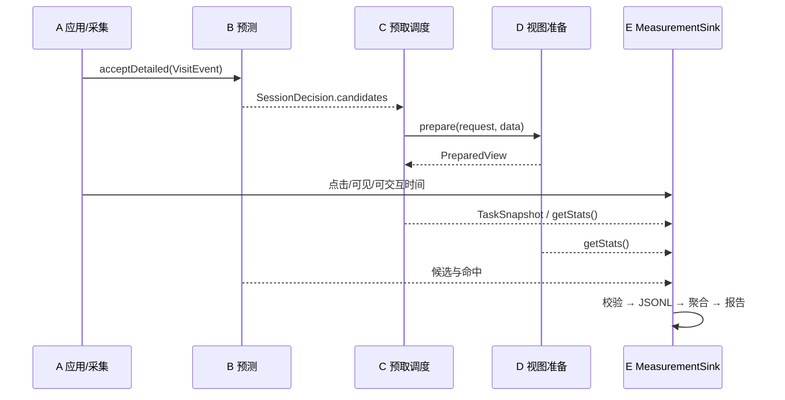

# E 模块：测量与评测

本模块把 A 的点击事件、B 的预测结果、C 的预取任务和 D 的视图生命周期汇总为一条可复查的交互记录。它首先回答“这次点击是否命中了提前准备的内容、页面多久可见、消耗了多少资源”，而不是先宣称优化收益。

当前交付是**主机侧 TypeScript 核心 + 受控主机场景 + 自动化检查**。没有 OpenHarmony 应用、设备或真实用户数据，因此所有报告保持 `deviceValidation: "not-run"`，不把合成场景的毫秒数写成设备点击加速或内存优化结论。

## 1. 模块边界

| 归属 | 内容 |
| --- | --- |
| E 提供 | `MeasurementSink` 实现、记录校验、指标聚合、报告 schema、主机回放场景、测试、pipeline 阶段、CI 摘要 |
| A 提供 | 脱敏 `VisitEvent`、点击/可见/可交互时间、真实会话别名、开关与清除时机 |
| B 提供 | `SessionDecision`：候选、边界、是否命中；E 只消费决策，不重复调用 `accept()` 学习 |
| C 提供 | `TaskSnapshot` 与 `getStats()`：任务状态、取消原因、失败码、持有字节 |
| D 提供 | `getStats()`：缓存、待构建、释放、晚到资源、过期和淘汰计数 |

E 不修改 A/B/C/D 的业务逻辑，也不把 `MeasurementSink` 扩展字段直接写入共享 `src/contracts.ts`；扩展方案见 [measurement-contract-rfc.md](measurement-contract-rfc.md)。

## 2. 数据流



同一次访问只允许调用一次 B 的 `acceptDetailed`。E 的测量是旁路记录，不改变调度时序；不要为了测量再调用 `accept()`，否则会重复学习。

## 3. 指标口径

### 3.1 交互与预测

**一次记录 = 一次点击到页面可见的交互 = 一个机会（opportunity）**。首次访问（`first-visit`）和断档（`gap`）也保留在分母中；没有候选就按“未预测”计入，不能通过删除未预测交互抬高覆盖率。

| 指标 | 定义 | 零分母行为 |
| --- | --- | --- |
| `interactions` / `opportunities` | 记录条数 | `0` |
| `predictionsMade` | `predictedPages.length > 0` 的记录数 | `0` |
| `hits` | `predictionHit=true` 的记录数 | `0` |
| `misses` | `predictionsMade - hits` | `0` |
| `coverage` | `predictionsMade / interactions` | `null` |
| `hitRateAll` | `hits / interactions` | `null` |
| `hitRateWhenPredicted` | `hits / predictionsMade` | `null` |
| `missRate` | `misses / predictionsMade` | `null` |
| `coldStartOpportunities` | `coldStart=true` 的记录数 | `0` |
| `coldStartShare` | `coldStartOpportunities / interactions` | `null` |

`hits` 必须是 `predictionsMade` 的子集：校验器要求 `predictionHit=true` 时 `actualPage` 出现在 `predictedPages` 中，避免“命中了但没有候选”的矛盾记录。

### 3.2 时间

| 指标 | 定义 |
| --- | --- |
| 点击到可见 | `visibleAtMs - clickedAtMs` |
| 点击到可交互 | `interactiveAtMs - clickedAtMs`（仅当平台提供可交互时间） |
| `clickToVisible` / `clickToInteractive` | `count`、`minMs`、`p50Ms`、`p95Ms`、`maxMs`、`meanMs` |

分位数使用**最近秩（nearest-rank）**：排序后取 `ceil(p * n) - 1` 位置的值，不做线性插值。样本数为零时整个统计量为 `null`，不返回 `0` 伪造“很快”。

所有时间必须来自同一个单调时钟并满足 `visibleAtMs >= clickedAtMs`、`interactiveAtMs >= clickedAtMs`。`VisitEvent.monotonicMs` 是会话内时钟，不能与 C/D 的进程单调时钟直接混用；E 的交互记录只使用 A 提供的点击/可见时间，不自行拼接跨时钟值。

### 3.3 资源与复用

| 指标 | 定义 |
| --- | --- |
| `prefetchedBytes` | 该交互之前为候选取回的数据字节总和；来自 C 的任务快照，不是 JSON 对象堆内存 |
| `wastedBytes` | 已取回但未被该交互消费的字节；预测落空、过期或取消时计入 |
| `wastedByteRatio` | `wastedBytes / prefetchedBytes`；无预取时为 `null` |
| `viewReusedInteractions` | `viewReused=true` 的交互数 |
| `viewReuseRate` | `viewReusedInteractions / optimizedInteractions`；分母是优化交互，不是全部交互 |

`prefetchedBytes` 和 `wastedBytes` 只能说明 C 的数据租约字节，不等于进程 RSS、ArkUI 视图内存或设备内存峰值。D 的 `estimatedBytes` 是适配器记账值，E 必须与真实内存分开报告。

### 3.4 分组

| 分组 | 用途 |
| --- | --- |
| `byOptimized.optimized` / `unoptimized` | 对照开启与关闭预取的耗时和命中 |
| `byPrediction.hit` | 有预测且命中 |
| `byPrediction.miss` | 有预测但落空 |
| `byPrediction.noPrediction` | 没有候选（冷启动、断档或模型弃权） |

三个预测分组互斥且并集等于全部交互。分组内的耗时统计仍使用最近秩分位数；空分组返回 `null`。

## 4. 记录 schema

`MeasurementRecord` 继承共享契约中的 `InteractionMeasurement`，并增加可选扩展字段。共享契约当前仍是：

```ts
interface InteractionMeasurement {
  interactionId: string;
  pageId: string;
  clickedAtMs: number;
  visibleAtMs: number;
  optimized: boolean;
  predictionHit: boolean;
}
```

E 的记录额外包含：

| 字段 | 必填 | 说明 |
| --- | --- | --- |
| `schemaVersion` | 是（存储） | 当前固定为 `1` |
| `sessionId` | 否 | 匿名会话别名；不写账号、设备 ID 或原始 URL |
| `interactiveAtMs` | 否 | 页面可交互的单调时间 |
| `coldStart` | 是（存储） | 会话首次访问 |
| `boundary` | 是（存储） | `first-visit`、`consecutive`、`gap` 或 `unknown` |
| `predictedPages` | 是（存储） | 上一轮发出的候选，不能使用未来访问结果 |
| `actualPage` | 是（存储） | 实际进入页面，必须等于 `pageId` |
| `preloadTaskId` | 否 | 关联 C 的任务 ID |
| `viewReused` | 是（存储） | 是否复用了 D 的视图；要求 `optimized=true` |
| `prefetchedBytes` | 是（存储） | 非负安全整数 |
| `wastedBytes` | 是（存储） | 非负安全整数，且不超过 `prefetchedBytes` |
| `dataKind` | 是（存储） | `synthetic`、`host-observed` 或 `device` |

A 只传共享契约字段也能写入：`normalizeMeasurement()` 会填充保守默认值（`dataKind=host-observed`、空候选、`unknown` 边界、零字节）。存储后再读取时 `parseMeasurementRecord()` 要求扩展字段齐全，防止报告悄悄丢失来源。

未知字段会被拒绝，而不是被静默丢弃；这能尽早发现拼写错误或未评审的字段扩展。

## 5. 数据来源与报告

| `scope` | 允许的 `dataKind` | 含义 |
| --- | --- | --- |
| `host` | `synthetic` / `host-observed` | 主机逻辑、合成 fixtue 或主机实际执行 |
| `device` | `device` | 真实设备/模拟器，必须记录设备与系统版本 |

`deviceValidation` 只能是 `not-run` 或 `run`。`deviceValidation=run` 必须同时满足 `scope=device` 且 `dataKind=device`；主机报告不能写“设备已验证”。

报告字段：

| 字段 | 说明 |
| --- | --- |
| `schemaVersion` | `1` |
| `scope` / `dataKind` / `deviceValidation` | 来源诚实性 |
| `timingSource` | 时间来源，例如 `controlled-host-clock` 或平台 HiTrace |
| `generatedAtUtc` | 生成时间 |
| `command` | 复现命令 |
| `config` | 解析后的场景/调度/预测配置 |
| `environment` | Node、平台、架构；设备报告另加型号/API |
| `provenance` | git commit、dirty、关键源码 SHA-256 |
| `metrics` | 第 3 节指标 |
| `notes` | 必须保留的限制说明 |

比较报告 `comparison.json` 额外保存 baseline/optimized 指标、delta、检查项、调度器/视图清理统计和逐任务轨迹。`delta.clickToVisibleP50SavedMs` 的定义是 `baseline.p50 - optimized.p50`，正数表示优化后 p50 更低；p95 同理。

## 6. 时序模型与限制

主机场景使用受控单调时钟，`fetchDelayMs`、`renderDelayMs`、`interactiveDelayMs` 是**场景参数**：

- 基线：每次点击都走前台取数（`fetchDelayMs`）再渲染（`renderDelayMs`）。
- 优化命中：直接取用已准备好的数据/视图，只付渲染时间。
- 优化落空或冷启动：取消旧预取，再走前台取数。

因此报告中的毫秒数只证明“测量与对照管线能区分命中/落空”，**不能**写成 ArkUI 真机点击加速、帧耗时或内存收益。真实结论必须等 A 交付应用与目标设备后，用相同场景重新测量，并保留 `dataKind=device`、设备型号、系统/API 版本和构建号。

当前场景的合成统计（每次运行应一致）：

| 指标 | 基线 | 优化 |
| --- | ---: | ---: |
| 交互 | 11 | 11 |
| 有预测 | 9 | 9 |
| 命中 | 7 | 7 |
| 落空 | 2 | 2 |
| 冷启动 | 2 | 2 |
| 点击到可见 p50 | 22 ms（场景值） | 2 ms（场景值） |
| 点击到可见 p95 | 22 ms（场景值） | 22 ms（场景值） |
| 复用视图 | 0 | 7 |
| 预取字节 | 0 | 2304（场景记账） |
| 浪费字节 | 0 | 512（场景记账） |

这些数字来自 `config/measurement-baseline.json` 的受控延时，不是设备数据；表中保留它们是为了让回归测试能发现指标口径变化。

## 7. 隐私与数据保留

- `pageId`、`dataKey`、`sessionId`、`interactionId` 必须是稳定匿名别名；不得写入账号、令牌、设备 ID、完整 URL、页面正文或业务数据。
- sink 只写出 schema 白名单字段，未知字段直接拒绝；报告中不保存原始请求体。
- 原始 JSONL 和报告写入 `artifacts/`，该目录不入 Git；保留期、访问控制和删除由 A/E 共同约定。
- 用户关闭采集或请求删除时，A 负责停止采集并通知 B/C；`B.clear()`/`C.clear()` 不应自动删除已经导出的评测报告，报告删除必须单独执行并记录。
- 真实数据接入前需要团队隐私说明和脱敏评审；E 的合成场景不包含任何个人数据。

## 8. 运行方式

```powershell
npm ci
npm run build

# 只运行 E 的主机测量场景
npm run verify:measurement

# 完整 pipeline（包含 measurement-evaluation 阶段）
npm run pipeline
```

输出：

```text
artifacts/measurement/<run>/
├── comparison.json
├── config.json
├── baseline/
│   ├── report.json
│   └── interactions.jsonl
└── optimized/
    ├── report.json
    └── interactions.jsonl
```

完整 pipeline 中该阶段位于：

```text
artifacts/pipeline/<run>/measurement-evaluation/<run>/
```

CI 归档整个 `artifacts/pipeline/`，并在 job summary 中输出测量摘要（`scripts/publish-summary.mjs`）。

## 9. 代码与测试入口

| 文件 | 用途 |
| --- | --- |
| `src/measurement/types.ts` | 记录、指标、报告类型 |
| `src/measurement/validation.ts` | 输入校验、JSONL 读写、扩展字段默认值 |
| `src/measurement/sink.ts` | `JsonlMeasurementSink`、内存 writer |
| `src/measurement/aggregate.ts` | 指标聚合与最近秩分位数 |
| `src/measurement/report.ts` | 报告构造与来源一致性校验 |
| `src/measurement/index.ts` | 模块导出入口 |
| `adapters/node-measurement-file.mjs` | 主机 JSONL 文件适配器 |
| `benchmarks/measurement.mjs` | B→C→D→E 受控主机场景与 CLI |
| `config/measurement-baseline.json` | 固定场景、延时参数和配置 |
| `tests/measurement.test.mjs` | 校验、sink、聚合、报告、文件适配器 |
| `tests/measurement-integration.test.mjs` | B/C/D/E 集成、确定性、JSONL 往返 |

## 10. 平台交接清单

A 接入时需要：

- [ ] 提供真实点击、可见和可交互时间，统一会话内或进程单调时钟，不混用墙上时间。
- [ ] 提供稳定匿名 `pageId`/`dataKey`/`sessionId`，并在采集关闭时停止写入。
- [ ] 对每次导航只调用一次 `acceptDetailed`，把候选按原顺序交给 C。
- [ ] 把 C 的任务 ID、D 的视图复用结果和真实字节估计交给 E。
- [ ] 在设备报告中记录设备型号、系统/API 版本、构建号、数据来源和 `dataKind=device`。
- [ ] 用同一设备、同一数据、同一顺序做开启/关闭对照；未运行项保持 `not-run`。

在完成这些检查前，E 的报告只能作为主机逻辑与测量管线证据，不能替代课程要求的真机性能结论。
