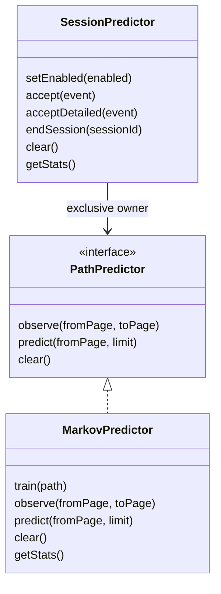
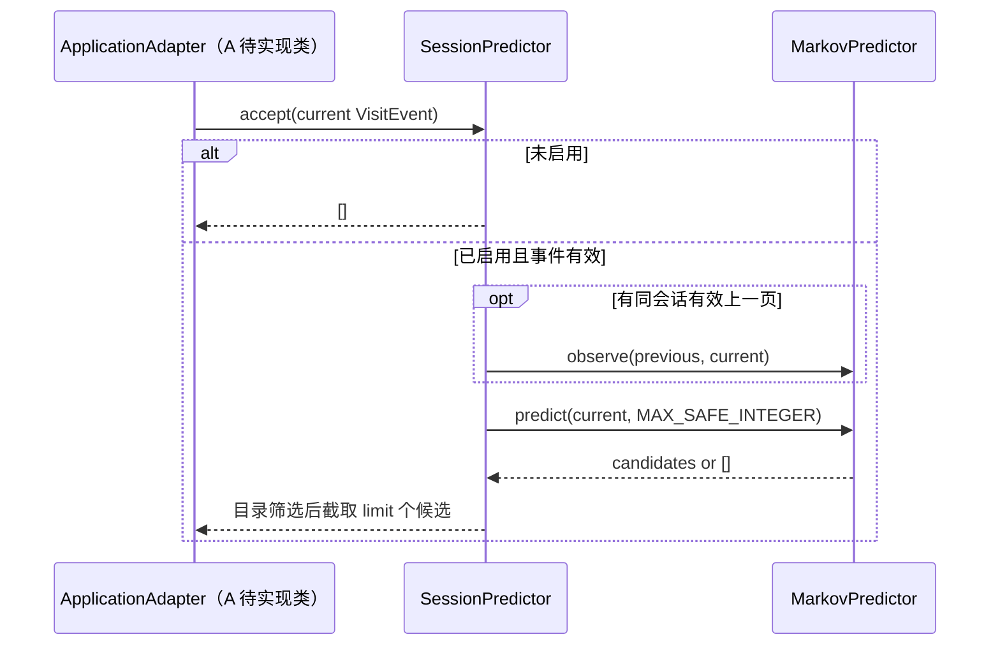

# B 模块：行为路径预测

本模块对照 [docs/target.md](target.md) 第 2–4、6、9 节实现预测侧交付：由已发生的访问历史预测下一页，限制历史状态，提供拒绝预测的门槛，保留逐跳离线证据。实现位于 `src/prediction/`，公共 `PathPredictor`、`Prediction`、`VisitEvent` 契约保持不变。当前运行验证为 Windows / Node.js 22 / TypeScript 5.9.3；OpenHarmony 系统、SDK/API、设备与 ArkTS 编译由 A 落实后再验证。

## 要求与边界

| 要求依据 | B 的实现及验收证据 | 上下游依赖 |
| --- | --- | --- |
| §3.1 预测输入、结果与实际下一跳可对应 | `MarkovPredictor`、路径/事件回放和逐步 `trace`；手算与在线时序测试 | A 提供真实、脱敏、按顺序的访问事件 |
| §2、§3.3 预测收益与资源浪费的权衡 | 有限滑动窗口、可配置样本/频率门槛；窗口计数独立参照测试、未使用候选计数 | C、D 决定空闲执行、任务数与资源预算 |
| §3.3 冷启动、快速切换、采集关闭 | 无历史返回空候选，会话隔离、乱序处理、关闭/重启/清除测试 | A 控制真实采集开关及会话生命周期 |
| §4、§6 路线比较、避免未来数据泄漏 | 四个基线与当前配置、在线/冻结评测、三段参数对照、逐跳原始结果及 SHA-256 | E 与 B 在真实路径上复测；不得挑选成功样本 |
| §9 模块、类、接口、顺序图、困难与参考 | 本文作为正式模板相关章节的模块素材 | A、E 汇入整体设计与正式交付 |

B 不调用平台采集、磁盘、网络、调度、视图或设备 API。C 负责空闲判定、预取、取消；D 负责真实视图复用及释放；E 组织整体对照测量。候选为空时仍须由上层处理旧任务，预测接口不能证明预加载、命中复用或回滚已经完成。源码参考链路属于整体验证，本模块没有引入或宣称追通上游 OpenHarmony 源码。

## 文件与类

| 文件 | 职责 |
| --- | --- |
| `src/prediction/index.ts` | B 模块导出入口 |
| `src/prediction/markov.ts` | 一阶转移统计、窗口淘汰、候选排序与筛选 |
| `src/prediction/session.ts` | 消费脱敏事件、会话游标、启用/关闭与清除 |
| `src/prediction/validation.ts` | 标识长度及正整数校验 |
| `src/prediction/config.ts`、`src/prediction/factory.ts` | 统一默认值、配置校验和应用/评测共用的创建入口 |
| `config/prediction.json`、`config/prediction-candidates.json` | 当前配置覆盖项和预先声明的候选/选择约束 |
| `tests/prediction.test.mjs`、`tests/session.test.mjs` | 模型、会话及异常边界验证 |
| `benchmarks/replay.mjs` | 共用先预测后学习评测函数 |
| `benchmarks/events.mjs`、`tests/events.test.mjs` | 经过真实会话接入器的事件回放、生命周期/投递时序验证 |
| `benchmarks/prediction.mjs` | 策略比较、数据格式校验、证据输出 |
| `benchmarks/sweep.mjs`、`benchmarks/artifacts.mjs` | 验证段选参、最终测试、不可覆盖的原始输入及配置证据 |
| `tests/config.test.mjs`、`tests/sweep.test.mjs` | 应用/评测一致性、配置拒绝、参数选择不读取最终测试结果 |
| `tests/replay.test.mjs`、`tests/prediction-evaluation.test.mjs` | 分母、冻结模式、逐跳记录和在线接入一致性验证 |



两类在调用方所在进程内同步执行，不创建线程、IPC 或平台服务；调用方应串行投递事件。一个 `SessionPredictor` 独占其模型，不应由其他代码并行训练或单独清除同一模型。没有自己的 UI；A 在应用中提供开关和删除历史入口。

## 模型及参数

模型使用窗口内计数 `N(from,to) / ΣN(from,*)`，只利用上一页预测下一页。按频率降序、页面标识的 UTF-16 字典顺序打破平局。未知页面、当前页样本不足或所有候选低于门槛时返回 `[]`；筛选和前 K 截断后不重新归一化。分数表示样本条件频率，不保证某次预测成功。实现：`src/prediction/markov.ts:82#predict`。

| `MarkovOptions` | 默认值 | 语义 |
| --- | --- | --- |
| `windowSize` | 2048 | 全部会话合计保留的最近转移次数，正安全整数 |
| `minSamples` | 1 | 当前页在窗口内的出边样本数门槛，正整数且不超过窗口 |
| `minProbability` | 0 | 候选条件频率下限，有限数且在 `[0,1]` 内 |

默认值用于兼容现有基线，是待实测的开发参数，不是课程指标或已调优值。较高门槛可能减少错误候选，也可能丢失大量可用预测；不能只看“有预测时命中率”。短窗口能遗忘旧热点，也会遗忘低频页面。一阶模型无法区分由不同早期路径到达同一页面的意图，后续若真实数据证明该问题明显，再比较多阶或序列模型。

环形历史填满后，每次更新淘汰一条旧转移，递减相应计数，删除零计数边和空行。更新使用常数次 Map 操作；预测对当前页的 `d` 条出边排序，开销随 `d log d` 增长。模型最多保留 W 条历史记录、W 条不同边、W 个源页面，标识最多 128 个 UTF-16 代码单元，限制可随 W 推导的状态规模；这不是字节内存上限。`getStats()` 仅返回结构计数。实现：`src/prediction/markov.ts:40#observe`、`src/prediction/markov.ts:105#getStats`。非法单条/训练输入在模型变更之前被拒绝；整条训练路径先校验，防止部分学习。实现：`src/prediction/markov.ts:72#train`。

## 会话接入与隐私

`SessionPredictor` 消费 A 已脱敏的 `VisitEvent`，不从页面自动采集。页面必须属于构造时复制的 `allowedPages` 目录；A 应将动态商品页映射为固定路由别名，如 `detail`，不得将 URL 查询参数、账号、内容或设备标识放进页面目录。会话 ID 应为临时匿名值，时钟为同会话单调毫秒数；标识非空且最多 128 个 UTF-16 代码单元。标识校验只是边界检查，不能自动证明脱敏。依据：`src/prediction/validation.ts:4#checkIdentifier`、`src/prediction/session.ts:40#constructor`。

| `SessionOptions` | 默认值 | 行为 |
| --- | --- | --- |
| `allowedPages` | 必填 | 固定页面别名列表，不能为空；输出也按此目录筛选 |
| `maxSessions` | 32 | 最多保留的会话游标数，按最近接收顺序淘汰 |
| `maxGapMs` | 1,800,000 | 同会话相邻事件间隔超过此值时不学习跨间隔转移；等于阈值可学习 |
| `limit` | 1 | 请求的最大候选数，正安全整数 |

这些同样是本地开发默认值。状态复杂度为模型窗口 W、会话数 S 和固定页面目录 P 的合计规模，不记录会话完整路径。应用必须让同一访问只进一个接入点，不要再手动调用 `observe`。

- 初始关闭；`setEnabled(true)` 后才学习和预测。`setEnabled(false)` 清除会话游标，关闭期间不检查/保留输入、不学习、不输出候选；既有聚合模型保留。
- 重新启用后，首条事件不会与关闭前的事件相连。`clear()` 清除聚合模型与游标，保留当前启用状态；如需停止并删除，应先关闭再清除。
- 只连接同一会话相邻事件，跨会话不比较时间。较早时间戳的迟到事件被忽略且不移动游标；相等时间戳按调用顺序处理。时钟重置后，A 必须生成新会话 ID 或调用 `endSession`。
- 未知/无效页面、无效时间抛错并清除该会话游标，防止跨越未记录导航。无效会话 ID 抛错。上层捕获错误后保持正常导航，必要时结束会话。
- 连续相同页面会学习自转移；同一回调重复投递与真实重新访问无法由当前契约区分，A 应只在确定的页面访问边界投递一次。
- `endSession(id)` 只删除该游标，既有转移统计保留。`clear()` 是逻辑删除，不承诺运行时内存的安全擦除，也不删除 A/E 另存的日志或评测文件。

对应实现：`src/prediction/session.ts:53#setEnabled`、`src/prediction/session.ts:60#accept`、`src/prediction/session.ts:108#endSession`、`src/prediction/session.ts:114#clear`。

目录过滤在前 K 截取之前完成；即使预训练模型包含不再可用的页面，也不会遮住后面的合法候选，条件频率仍保留原分母。接入器请求模型的完整排名再筛选，所以调用方应提供有容量限制的模型，本项目默认模型的不同边数不超过窗口 W。

关闭采集或删除历史时，A 还须通知 C 取消已有任务、通知 D 释放准备资源，并处理晚到资源。B 的开关只控制 B 的状态。当前没有持久化、用户画像或自动上传；外部保存的评测输入和结果仍应脱敏、受访问控制并有删除策略。

## 提供接口与调用示例

```javascript
// 主机调用示例：npm run build 后，在仓库根目录运行。
import { readFileSync } from 'node:fs';
import { createPredictionEngine } from './dist/prediction/index.js';

const profile = JSON.parse(readFileSync('./config/prediction.json', 'utf8'));
const engine = createPredictionEngine(['home', 'list', 'detail'], profile);
const prediction = engine.session;
prediction.setEnabled(true); // 仅在应用已取得许可且采集启用后调用
prediction.accept({ sessionId: 'temporary-session', pageId: 'home', monotonicMs: 0 });
prediction.accept({ sessionId: 'temporary-session', pageId: 'list', monotonicMs: 10 });
const next = prediction.accept({ sessionId: 'temporary-session', pageId: 'home', monotonicMs: 20 });
console.log(next); // [{ pageId: 'list', probability: 1 }]
prediction.setEnabled(false);
prediction.clear();
```

示例中的文件读取属于 Node 主机。鸿蒙应用由 A 使用目标平台的资源加载方式取得同一配置对象，再调用同一个工厂函数；工厂和核心模型不导入 Node 模块。直接构造模型仍可用，但不会自动读取 JSON 文件；正式接入应明确传入共享配置。

### 配置的单一来源及生效顺序

`config/prediction.json` 是部分覆盖文件，其 `schemaVersion` 为 1。空对象继承 `DEFAULT_PREDICTION_CONFIG`，避免在文件和构造器中复制多套默认值；完整解析结果不可变。模型和会话构造器也调用同一套校验。未知字段、错误版本、null、数值字符串或不合法门槛会失败，不会静默忽略。依据：`src/prediction/config.ts:73#resolvePredictionConfig`、`src/prediction/factory.ts:7#createPredictionEngine`。

例如覆盖文件可填 `model.windowSize`、`model.minSamples`、`model.minProbability`，以及 `session.maxSessions`、`session.maxGapMs`、`session.limit`。规则与上面的参数表一致，调整后不需要修改算法源码。当前文件保留原默认行为，没有依据合成样本改用短窗口。

Node 命令默认读取该文件，`--config` 可指定另一份配置。数据集记录的 maxSessions/maxGapMs 随后覆盖配置中的对应会话值，`--top-k`（若指定）最后覆盖候选数；报告同时保存 `profile` 和 `effectiveConfig`。复现实际应用时，应使用记录时的会话策略，并让 A 对照生效配置确认一致性。

对照里的 `recent-window`、`guarded-window` 保留既有实验含义，其默认值集中在 `DEFAULT_COMPARISON_MODEL`；`--window-size`、`--comparison-min-samples`、`--comparison-min-probability` 只修改这些实验项。新增 `configured` 始终评测当前生效配置，便于与应用工厂对照；实验参数不会暗中修改应用配置。

`accept` 先学习刚刚结束的上一页→当前页，再预测当前页的下一跳。预测只使用到当前访问为止的历史，没有等待或访问未来事件。没有会话信息时，可直接用 `PathPredictor.observe/predict`，但此时由调用者自己保证相邻性、开关与清除。

`acceptDetailed(event)` 返回 `SessionDecision`，与 `accept(event)` 使用同一实现。一个事件选择其中一个方法调用一次：

| 字段 | 语义 |
| --- | --- |
| `status` | `accepted`、`disabled` 或 `out-of-order`；迟到事件不等于无历史时的正常空候选 |
| `boundary` | 正常访问为 `first-visit`、`gap` 或 `consecutive`；被忽略的访问为 `null` |
| `transition` | 合法同会话相邻转移的 `fromPage/toPage`，否则为 `null` |
| `evictedSessionId` | 本次接收淘汰的临时会话 ID；没有淘汰则为 `null` |
| `candidates` | 当前页的下一跳候选；不包含调度任务或视图资源 |

详细接口依据：`src/prediction/session.ts:18#SessionDecision`、`src/prediction/session.ts:65#acceptDetailed`。该接口使 A、E 可沿用 B 的边界判断，不需要另写一套会话状态机。



图中外部 `ApplicationAdapter` 是 A 待实现的应用接入类，不代表已存在的平台代码。A 在真实访问时先核对上一轮准备任务是否命中，协调 C、D 取消落空项，再据候选发起新一轮准备。B 返回的候选和频率不等于 `PreloadRequest.priority`；优先级方向、任务 ID、调度回调由 A、C、D 共同评审，B 不私自修改共享契约。

## 评测、数据格式与复现

```powershell
npm run pipeline
npm run evaluate:prediction
npm run build
node benchmarks/prediction.mjs --mode frozen --top-k 2
node benchmarks/prediction.mjs --input benchmarks/fixtures/prediction-scenarios.json --window-size 64 --mode online
node benchmarks/prediction.mjs --input benchmarks/fixtures/prediction-events.json --mode online
node benchmarks/prediction.mjs --input benchmarks/fixtures/prediction-events.json --mode frozen --top-k 2
npm run sweep:prediction
```

主机侧完整 pipeline 已加入 B 的策略对照阶段。独立命令的报告位于 `artifacts/prediction/<run>/report.json`；pipeline 报告位于当次 `artifacts/pipeline/<run>/prediction-evaluation/<run>/report.json`，连同原样 `input.json` 被现有 Actions 归档。CLI 非法输入返回非零退出码，不生成成功报告。要评测自己的数据，将 `--input` 参数换成脱敏文件的实际路径，其格式如下。

输入采用以下格式；训练集合应在评测起点之前取得，评测会话按真实时间顺序排列，训练/评测划分与样本来源由提供者确认，工具不能识别伪造的来源声明：

```json
{
  "schemaVersion": 1,
  "dataKind": "synthetic",
  "source": "合成测试；真实脱敏数据须填写来源、取得时间、授权与划分方法",
  "pageCatalog": ["home", "list", "detail"],
  "scenarios": [{
    "name": "example",
    "trainingSessions": [["home", "list", "detail"]],
    "evaluationSessions": [["home", "list", "detail"]]
  }]
}
```

`dataKind` 只接受 `synthetic` 或 `anonymized-real`，后者仅是提供者声明，不是工具认证。单个空会话、单页会话合法但没有预测机会；整个场景集合不能为空、场景名须唯一、路径须只含目录内页面。数据校验在模型训练之前执行。实现：`benchmarks/prediction.mjs:28#validateDataset`。

每个场景/策略都新建模型，训练只在各自会话内连接页面，评测不连接会话边界。在线路径模式在每次机会先预测再学习真实下一跳；冻结模式不学习评测转移。完整历史策略的容量按该场景转移数的上界取足，仅为不淘汰历史，不使用评测页面标签设规则或门槛。实现：`benchmarks/replay.mjs:8#evaluateSessions`、`benchmarks/prediction.mjs:156#comparePredictors`。

此第一版路径格式没有事件时间戳，也不执行会话超时、淘汰和开关逻辑。输入需已按这些边界分段，会话互不重叠且按时间排列。包含交错会话、超时或开关的数据使用下面的第二版事件格式，不能先按会话 ID 分组再冒充实时评测。

### 第二版事件格式

已有可执行样例为 `benchmarks/fixtures/prediction-events.json`。对应的最小格式：

```json
{
  "schemaVersion": 2,
  "dataKind": "synthetic",
  "source": "示例；实际数据需说明来源、授权和训练截止时间",
  "pageCatalog": ["home", "list"],
  "sessionOptions": { "maxSessions": 32, "maxGapMs": 1800000 },
  "scenarios": [{
    "name": "event-example",
    "trainingEvents": [],
    "evaluationEvents": [
      { "order": 1, "kind": "set-enabled", "enabled": true },
      { "order": 2, "kind": "visit", "visit": { "sessionId": "temporary", "pageId": "home", "monotonicMs": 0 } },
      { "order": 3, "kind": "visit", "visit": { "sessionId": "temporary", "pageId": "list", "monotonicMs": 10 } }
    ]
  }]
}
```

`order` 是实际投递顺序的全局正安全整数，在同一场景的训练及评测数组中必须严格递增；不能按各会话的 `monotonicMs` 重新排序。会话内时间允许迟到投递，按实时接入器规则忽略。四种事件分别是：`visit`、`set-enabled`、`end-session`（带 sessionId）和 `clear`。事件及访问对象不接受额外字段，避免把账号、URL 内容或其他原始字段误带进标准导出；这仍不自动证明字段值已脱敏。实现：`benchmarks/events.mjs:13#validateEventSequence`。

回放默认关闭；需显式启用。训练事件先通过同一 `SessionPredictor`，在训练/评测切分处清除会话游标，保留模型与开关状态，避免切分边界串联。评测继续经过真实接入器，核对的是上一次实际输出的候选，当前事件不会重新生成一个“过去的预测”。在线模式学习已发生转移；冻结模式停止学习评测转移，但仍执行关闭、会话结束与显式历史清除。实现：`benchmarks/events.mjs:52#evaluateEventStream`。

超时、首访、被淘汰后重新出现的会话不构成相邻机会；关闭和迟到事件也不计入分母。报告的 `visitCounts` 单独列出这些访问，不能只选择其中命中的访问。事件 trace 保存原事件、详细决策和上一轮候选的实际命中结果。训练/评测数据仍须由提供者按真实时间切分，`order` 校验无法认证其来源。

合成 fixture 故意含关闭期投递，用于验证忽略行为；真实应用在关闭采集后应停止记录行为，而不是持续采集后交给 B 过滤。

报告本身现为第二版，`inputFormat` 区分 `session-paths` 与 `event-stream`，E 读取 trace 时应先检查此字段。第一版输入文件继续受支持。事件模式结果归档在本次 pipeline 的 `prediction-event-evaluation/` 子目录，不覆盖此前记录。

### 参数批量对照与最终测试

独立命令为 `npm run sweep:prediction`。编译后可使用 `node benchmarks/sweep.mjs --input benchmarks/fixtures/prediction-sweep.json --config config/prediction.json --candidates config/prediction-candidates.json --mode frozen`。输出在 `artifacts/prediction-sweep/`，pipeline 中则归档在当次 `prediction-parameter-sweep/`。

批量输入版本为 1，必须声明 `inputFormat`、`dataKind`、`source`、`pageCatalog` 和非空场景集合。路径格式场景提供 `trainingSessions`、`validationSessions`、`testSessions`；事件格式对应 `trainingEvents`、`validationEvents`、`testEvents`，事件 order 在三段之间也必须严格递增。可执行样例见 `benchmarks/fixtures/prediction-sweep.json`；缺少任何一段、乱序或不合法页面都会失败。依据：`benchmarks/sweep.mjs:31#validateSweepDataset`。

候选文件版本为 1，`candidates` 中每项有唯一 id 和相对当前配置的 `overrides`，使用与应用相同的解析器。候选可改变模型参数和候选数；maxSessions/maxGapMs 必须固定，避免改变分母制造虚假收益。`selection` 在评测前声明，包含：

| 字段 | 默认规则与含义 |
| --- | --- |
| `metric` | 固定为 hitRateAll |
| `minCoverage` | 默认为 0，范围 [0,1]；排除覆盖过低的候选 |
| `maxMeanCandidates` | 默认为 1，须为正有限数；限制已评分候选数 / 机会数 |

仓库候选文件预设覆盖率 0.25、平均候选数不超过 1，均是实验选择约束，不是课程指标。平均候选数不等于真实内存/网络开销，事件模式另外保留失效和未决候选记录。

每个候选只用训练段建模、验证段比较；跨场景先汇总机会、命中与候选计数，再计算比率，不平均场景比率。在满足约束的候选中，按验证段 hitRateAll 降序、平均候选数升序、窗口升序、id 字典序确定结果。无验证机会或无合格候选时返回 selected=null、test=null，不偷偷换用最终测试挑选。

选中后只对该配置重新训练：用全部训练＋验证历史作为过去数据，再清除会话游标进入最终测试段。在线模式在最终测试中可继续学习已发生事件，冻结模式不学习最终测试转移。报告不会给其他候选生成最终测试分数，不根据最终测试结果重新排名。修改最终测试标签或长度不能改变验证排名；此项有专门回归测试。依据：`benchmarks/sweep.mjs:70#sweepConfigurations`。

命令不会覆盖 `config/prediction.json` 或部署选中配置；真实应用参数应在来源可靠的数据与目标环境验证后确认。报告保存原始 input/config/candidates 文件、各自 SHA-256、全部验证段记录、选中配置及最终测试记录。候选清单和约束应事先固定，工具不能证明提供者从未根据看过的最终测试数据手动改过实验。

| 输出 | 定义 |
| --- | --- |
| `opportunities` | 路径模式为各会话 `max(页面数−1, 0)` 之和；事件模式为接入器认可的相邻转移数 |
| `predictionsMade` | 候选非空的机会数 |
| `hits` | 真实下一页位于前 K 候选的机会数 |
| `coverage` | predictionsMade / opportunities |
| `hitRateAll` | hits / opportunities |
| `hitRateWhenPredicted` | hits / predictionsMade |
| `misses` | predictionsMade − hits，即非空候选但没有命中的机会数 |
| `candidatesIssued` | 所有机会输出候选数之和 |
| `unusedCandidates` | candidatesIssued − hits；只是未用候选数，不是设备浪费内存/网络量 |

事件模式另外给出 `totalCandidatesIssued`（所有评测访问实际发出的候选总数）、`discardedCandidates`（因超时、关闭、结束、清除或淘汰而失效）、`unresolvedCandidates`（输入结束时尚未等到下一次有效访问）。三者与已评分候选满足：`totalCandidatesIssued = candidatesIssued + discardedCandidates + unresolvedCandidates`。它们是预测记录计数，不能叫作实际资源回收量。

分母为 0 的比例返回 `null`。前 K 模式即使命中，也可能有 K−1 个候选未用，不能把前 K 命中直接当作省资源。每个策略保存初末结构计数与逐操作主机计时。事件模式只记录实际执行的评测预测和学习计时，不含训练、不含全部会话逻辑或 UI 耗时；冻结模式仍可能因 clear 事件改变最终模型。报告还保存输入与源码 SHA-256、Git 基线和 dirty 状态、Node/平台/架构及参数。工作区未提交时不能把 Git 基线当作实现版本，须同时依据源码校验值；独立报告不会自动进入 Git。

计时是未预热的共享进程操作耗时，包含主机噪声，不是稳定微基准或点击加速结果；结构计数不是实测内存。所有现有 fixture 都是合成数据，`openHarmonyPerformanceMeasured` 固定为 `false`。

## 当前验证与取舍

2026-11-02，本地完整 pipeline 通过，39 项测试全通过；其中窗口模型以独立滚动列表参照比较 2,000 次更新，并覆盖唯一页面持续增长、清空重训、窗口满时非法输入、会话交错、关闭重启、乱序/等时事件、游标淘汰、时间断点、目录拒绝、数据删除、冻结评测及在线接入与回放一致性。逐次结果见本地 `artifacts/pipeline/2026-11-02T03-17-40-396Z-9968d1c7/`；本记录仅对应本次主机验证。

后续补充：候选目录先筛选再截取的回归测试、详细决策测试，以及事件回放的交错、超时、开关、清除、淘汰和冻结模式测试已加入。新增 200 次动作的直接调用与回放一致性对照，并核对候选计数守恒、冷启动防泄漏和前 K 候选未用计数。

配置及批量对照加入后，本地完整 pipeline 通过，共 67 项测试。新测试覆盖共享配置默认值、不可变性与错误拒绝、应用工厂和 configured 评测一致性、最终测试标签/长度不影响选参、选择约束、稳定平局处理、按机会加权汇总和无合格候选。验证产物为 `artifacts/pipeline/2026-11-02T04-04-59-978Z-9ffd64c7/`；此前记录作为历史保留。

文中 TypeScript 等受支持的源码引用使用课程 `oh_verify.py` 按精确行号（window=0）核验；该工具不扫描 `.mjs` 扩展名，本文的 `.mjs` 引用另按文件、精确行号及符号核对。工具忽略的 `report.json`、`input.json` 是动态生成的产物名，不是源码引用。核验记录位于本地 `artifacts/verification/prediction/`。

当前默认合成对照为 W=16、K=1、在线更新；门槛策略另取最小样本 3、频率 0.6，这些是预先设定的实验参数，与产品默认 W=2048 分开。

| 合成场景 | 完整历史：命中/机会 | 近期窗口 | 门槛窗口 | 最近后继 |
| --- | --- | --- | --- | --- |
| 重复路径 | 8/8 | 8/8 | 6/8 | 8/8 |
| 歧义路径 | 5/7 | 5/7 | 1/7 | 3/7 |
| 路径变化 | 10/23 | 17/23 | 15/23 | 21/23 |
| 冷启动 | 1/4 | 1/4 | 0/4 | 1/4 |

这些观察支持保留窗口与门槛为可配置项，同时显示严格门槛可能降低全体机会命中率。最近后继在本次路径突变里适应更快，在交替歧义路径里更差；没有一种策略在这些例子中全面占优。当前交付选有界统计模型作为可解释、可直接接入的默认实现，不据此宣称真实用户效果最好，也未据合成数据调优设备参数。

## A、C、D、E 的交接与验收入口

B 可独立交付的入口和生命周期已实现；下表是其他成员按现有契约接入时需满足的条件，不代表对应平台代码已经完成。

| 对接方 | 可直接使用的交付 | 对方接入义务及验收 |
| --- | --- | --- |
| A 应用/采集 | `src/prediction/index.ts`、SessionOptions、VisitEvent、SessionDecision | 提供固定页面目录、匿名会话及会话内单调时钟；按实际投递顺序调用一个接入方法一次；明确页面访问边界；默认关闭并接上真实开关 |
| A 与 C 调度 | accepted 决策的 candidates、transition、boundary、evictedSessionId | 先核对上一轮实际访问，再创建新任务；忽略 out-of-order；超时/淘汰/会话结束时清理对应旧任务；任务 ID 和优先级由应用与调度确定，不把概率直接当优先级 |
| A 与 D 资源 | 由应用维护的候选/任务映射 | 关闭或清除时协调取消与资源释放；预测器不持有视图，清除预测历史不能代替释放视图或处理晚到资源 |
| E 评测 | 两版回放输入、四基线＋configured 比较、三段参数对照、trace、原始输入/配置/源码校验值及自动检查 | 按 inputFormat 解析报告；真实数据应带来源、授权、训练截止时间和实际事件顺序；使用事件模式核对生命周期，不用路径模式推断端到端收益 |

共同接入时，先运行 `npm run pipeline`；再用自己的脱敏事件文件运行比较命令。`tests/session.test.mjs` 与 `tests/events.test.mjs` 给出可执行行为范例。若上层捕获异常后继续导航，应同步结束对应会话和旧任务，避免把丢失事件前后的页面连接。

无需等待其他模块即可完成的 B 实现、回归测试、事件数据接入和文档已提供；没有用假的采集器、调度器或预渲染器代替其他成员的模块。接下来应保留以下真实依赖，不预先写通过结论。

## 团队后续验收

1. A 确定目标 OpenHarmony、SDK/API 与工程接入方式，验证 B 代码在实际目标语言/构建器中的兼容性；类型检查不能代替 ArkTS 构建。A 投递真实路由别名、临时会话 ID 和单调时间，B 配合修正模块兼容问题。
2. A、C、D 将候选接到真实空闲预取及视图准备，验证命中、落空、取消、内存压力和晚到资源释放；B 仅输出候选，不操作资源。
3. B、E 用来源明确、按时间划分的真实脱敏路径复跑在线/冻结对照，记录覆盖率、命中率、未用候选和模型开销，再决定路线及参数；单人或单场景统计不能外推到所有用户。
4. E 组织同设备/版本/数据/路径的关闭优化与开启优化对照，保存点击可见/可交互耗时、内存、CPU/网络与稳定性证据。当前没有这些设备结果，不标记整项 P07 完成。

本文不覆盖原始 DOCX/PPTX；可作为其模块设计、类图、业务流程、接口、困难与思考章节的素材。上游要求引用见 target.md，算法及接入代码为本项目实现，无新增第三方运行依赖。
