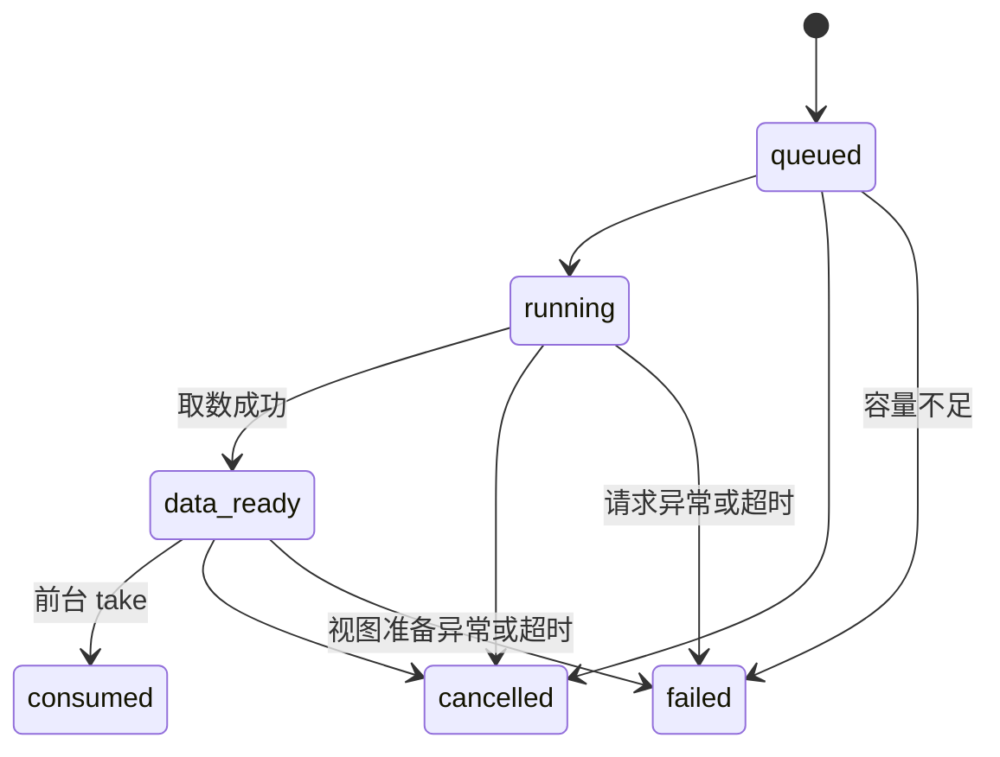

# C 模块：调度与数据预取

本模块将预测候选转为可取消、可追踪的数据准备任务。核心实现为平台无关 TypeScript；已提供 Node 22 HTTP 适配器和主机侧功能验证。OpenHarmony 空闲信号、SDK HTTP 适配器、ArkTS 构建和 D 的真实视图实现尚未验证。整体交付安排见 [项目执行计划](project-plan.md)。

## 职责与当前交付

| 能力 | 当前实现 | 验证入口 |
| --- | --- | --- |
| 空闲准入 | 显式 idle、foregroundBusy、memoryPressure 三个输入，初始不空闲且关闭 | `tests/preload.test.mjs` |
| 优先级与并发 | 数值越大越优先，同级 FIFO，一个实际执行槽 | 同上 |
| 内容去重 | 按 sessionId、pageId、dataKey 去重，重复 taskId 幂等，冲突拒绝 | 同上 |
| 预取与错误 | 泛型数据租约、超时、TTL、无自动重试；Node HTTP 支持响应大小限制与数据校验 | `tests/preload-http.test.mjs` |
| 生命周期 | 取消、关闭、会话结束、清除、内存压力，晚到结果清理 | `tests/preload.test.mjs` |
| C→D 交接 | 数据借用、视图异步准备、匹配校验、晚到释放、前台接管 | 核心协议测试及 `tests/preload-preparation.test.mjs` 使用 D 资源管理器的合并回归；真实视图待平台验证 |
| A/B→C 交接 | 按上一轮任务核对命中，再处理新一轮第一个候选；空候选仍清理旧任务 | `PredictionPreloadController` 与真实 B 联调测试 |
| 证据 | 本地真实 HTTP 请求、主动中止、503 失败、任务轨迹、源码 SHA-256 | `npm run verify:preload` |

## 接口与调用方式

所有公开入口通过 `src/preload/index.ts` 导出。共享 `PreloadScheduler.enqueue/cancel` 保留原签名；`PreloadRequest` 新增可选 `dataKey/sessionId`，`CancelReason` 扩展生命周期原因。增加联合类型成员可能影响下游穷举检查，A、D 应在合并评审时确认。

| 接口/类型 | 调用方及含义 |
| --- | --- |
| `DataPreloadScheduler<T>(fetcher, runtime, options?, preparer?)` | C 核心；依赖注入，无 Node、HTTP 或 SDK 依赖 |
| `enqueue(request)` / `cancel(taskId, reason)` | A 提交任务及使其失效 |
| `setEnabled(boolean)` | 默认关闭；关闭取消所有 C 持有任务，不释放前台接管资源 |
| `setEnvironment({idle, foregroundBusy, memoryPressure})` | A/平台适配器提供完整环境快照；不通过延时推断空闲 |
| `take(taskId)` | 立即返回可用的 `PreparedPreload<T>`；未就绪返回 undefined，前台正常加载 |
| `endSession(sessionId)` / `cancelAll(reason)` | 单会话或全局失效；必须关联 B 的超时、淘汰和会话结束 |
| `clear()` | 取消已有任务并删除内部历史；借出的数据等下游结束后释放，不重新写回已清除历史 |
| `getTask(taskId)` / `subscribe(listener)` | 不可变任务快照；订阅返回取消函数，不包含数据正文或异常原文 |
| `getStats()` | 资源字节、实际执行槽、任务数、状态进入计数及适配器/观察者错误计数 |
| `DataFetcher<T>.start(request)` | 返回 `{result, cancel}`；即使取消也必须让 result 最终结束 |
| `SchedulerRuntime` | 单一进程单调时钟与一次性定时器；schedule 不可同步执行回调 |
| `DataViewPreparer<T>` | D 适配接口：`prepare(request, data)` 和 `cancel(taskId, reason)` |

`taskId` 是每次准备的唯一标识，禁止业务主动复用；相同任务重复入队不会复活终态。记录有界淘汰后不再提供全生命周期唯一性检查。`sessionId` 是匿名会话别名。`pageId` 是稳定路由别名；`dataKey` 必须区分内容参数、数据版本与权限范围，不包含原始账号、令牌或完整 URL。缺省 sessionId 为 `default`，缺省 dataKey 为 pageId，仅适合内容固定的页面。

同会话、同页、同内容的另一个任务会记为 `cancelled/superseded`，不创建第二份请求，也不提供别名租约。跨会话不共享数据。调用方若要更改优先级，应取消旧任务并创建新 taskId。

### A 的接入顺序

1. 路由/交互开始时立即更新 `foregroundBusy=true`，禁止新投机任务并取消正在执行的任务。已完全就绪的结果仍可被 take。
2. 对事件只调用一次 B 的 `acceptDetailed`。乱序事件跳过 C；超时边界、游标淘汰和结束事件先调用对应 `endSession`。
3. 将实际页面映射为 `{pageId, dataKey}`。候选按 B 输出顺序映射，显式设置优先级，例如排名 `i` 映射为 `-i`；不直接把 probability 当作优先级。
4. 调用控制器 `visit(sessionId, actual, candidates)`：先取上一轮精确内容命中，再取消落空/未完成任务，最后只提交新列表的第一个候选。返回 bundle 时前台接管，无返回时走正常加载。
5. 页面稳定且平台空闲信号成立时更新 `{idle:true, foregroundBusy:false, memoryPressure:false}`。内存压力解除必须由平台重新通知，不能自行过一段时间后恢复。
6. 功能关闭和历史删除同时通知 A 的采集、B、C；如果 D 还有 C 之外的缓存，由 D 单独清除。控制器必须独占调度器，禁止混用其自动 taskId 与手工任务。

示意代码中的 `platformFetcher/platformRuntime/platformPreparer/readEnvironment/mapTarget` 由 A、C、D 在已确定 SDK 后实现，并非已存在的系统 API：

```ts
const scheduler = new DataPreloadScheduler(platformFetcher, platformRuntime, profile, platformPreparer);
const controller = new PredictionPreloadController(scheduler);
// 用户开启时，同时启用真实采集与 B。
controller.setEnabled(true);
scheduler.setEnvironment(readEnvironment());

const decision = prediction.session.acceptDetailed(event); // 本次事件仅调用一次
if (decision.status === 'accepted') {
  if (decision.boundary === 'gap') controller.endSession(event.sessionId);
  if (decision.evictedSessionId) controller.endSession(decision.evictedSessionId);
  const prepared = controller.visit(event.sessionId, actualTarget,
    decision.candidates.map((candidate, rank) => ({ ...mapTarget(candidate), priority: -rank })));
  // prepared 的 view/data 由页面接管；页面最终释放时只调用 prepared.dispose()。
}
```

B 只能预测页面；若详情页的具体数据参数无法在点击前可靠确定，应不提交该候选。禁止点击后读取真实参数，再伪称该内容在点击前已经预测。

## 状态、取消与资源归属



实际状态字符串为 `data-ready`。传入 D 后，`preparingView=true`，此时数据已取回但不可 take；D 完成后发布同状态的新快照，`viewReady=true`。没有 D 时数据就绪即允许 take，不能称作视图预渲染。`transitions` 对进入状态计数，同状态的准备标志更新不重复计数。

订阅通知按状态发生顺序发送给所有观察者。观察者同步取消任务时，当前状态先通知其余观察者，再通知取消；状态查询立即反映取消结果。环境输入只复制三个布尔字段并冻结，`getStats()` 返回值不能修改空闲条件。淘汰过期队列项后重新比较优先级，包含淘汰通知期间新入队的任务。

取消先进入终态，再尽力终止网络/视图准备。底层 result 未结束时继续占用执行槽；不会因重复取消叠加新的实际请求。若适配器永不结束，该实例将保持 busy，应修复适配器或结束其所属平台资源；核心不会偷偷释放槽再堆积请求。

数据由 C 持有；D.prepare 借用它直到 Promise 结束。取消期间不会抢先销毁 D 正在使用的数据；D 返回的晚到视图先 dispose，再释放数据。D 必须在拒绝 Promise 前自行清理尚未返回的半成品资源，并使 cancel 幂等。C 校验返回视图的 taskId/pageId，但内容正确性仍由 D 实现。

take 成功后，数据与视图整体转给前台。前台最终调用 bundle.dispose()，其内部重复调用安全。之后后台 clear、过期或内存压力都不会回收这份前台租约；调用方不得再单独释放其内部 data/view，以免重复清理。

原 `ViewPreparer.prepare(request)` 没有数据参数和逐任务取消协议，不能直接当作本适配器使用。现已合入 D 的 [ResourceViewPreparer](preparation.md)，仍需薄适配层：把预取数据借给构建器，await prepare 后立即通过 D.take 将视图移交 C，最后由 C.take 移交前台。不得同时把同一视图放进另一套 take 缓存，避免双重所有权。D.cancel 支持共享 CancelReason 的全部八个原因；C 的 timeout 在适配层映射为 expired，C 自身仍记录 failed/timeout。

`tests/preload-preparation.test.mjs` 的适配器仅为主机交接示例，已检查具体内容绑定、对象身份、全部取消原因、晚到释放和准备失败。它不替代 SDK 适配器；平台接入还须限制移交给 C 后的视图总量/字节，不能认为 D 已移出缓存的视图仍受 D 缓存预算控制。

## 配置、预算与异常

| 参数 | 主机开发默认值 | 语义 |
| --- | --- | --- |
| timeoutMs | 3000 ms | 从运行开始覆盖取数与视图准备，不含排队 |
| ttlMs | 5000 ms | 从入队开始的总有效期，含排队和准备；无自动续期 |
| maxTasks | 8 | 包含排队、就绪及取消后尚未结束的任务 |
| maxBytes | 8 MiB | C 持有数据租约声明的 byteLength 总额；不足时按入队顺序淘汰已就绪项 |
| historyLimit | 128 | 内部终态快照上限；外部订阅日志由 E 另行管理 |
| Node maxResponseBytes | 1 MiB | HTTP 流实际读取字节上限，超过即取消读取 |

以上默认值集中在代码导出常量，不是设备最优值或课程门槛。配置在实验前固定，并保存解析后的 options。所有参数为正安全整数；定时器不超过可移植范围。超时和 TTL 即使延迟派发，也会在接收结果、交给 D、前台 take 前检查。

`maxBytes` 不是操作系统内存上限：JSON 解码对象、正在接收的缓冲、适配器内部资源、D 的 GPU/视图资源和前台租约都可能额外占内存。平台适配器须约束单次响应，D 须另外设置视图预算，E 须实测进程内存。不可用 heldBytes 代替内存峰值。

失败码为 fetch、invalid-data、prepare、timeout、budget、capacity。异常正文不写入快照，防止泄漏 URL 或业务数据；适配器错误定位应另走脱敏诊断通道。观察者异常不打断调度，取消/释放异常计入统计；非零 cleanupErrors 必须调查，不能视为已经成功释放底层资源。

清除后内部历史删除；取消中的原资源须等适配器结束才能释放。已导出的评测报告不会被 clear 自动删除，A/E 负责它们的访问控制、保留和删除策略。identifier 长度检查只能限制结构，无法自动认证字段值已脱敏。

## 运行、证据及平台交接

```powershell
npm ci
npm run pipeline
# 或只执行 C 的实际 HTTP 功能场景（自动构建）
npm run verify:preload
```

HTTP 场景在 127.0.0.1 临时端口启动本地服务，经过现有 B 模型产生候选，执行一次实际取数和消费、一次请求中止、一次 HTTP 503 失败。fixture 内容是合成数据，空闲是手工输入；不依赖外部网络服务。证据写到 `artifacts/preload/<run>/report.json`；完整 pipeline 写到其独立 `preload-http-functional/<run>/` 下，并由已有 Actions 归档。

报告保存任务状态/单调时间、服务端收到/中止事件、有效配置、Node/平台、命令、Git 基线及 dirty、执行源码校验值。`openHarmonyPerformanceMeasured=false`、`realViewReuseMeasured=false`；没有设备加速、真实用户命中率或真实 UI 复用结论。主机 HTTP 原始数据不能用于三组设备性能对照。

2026-11-05（北京时间），复核后的 Windows / Node 22.19.0 完整 `npm run pipeline` 通过：101 项测试全通过，其中 C 新增 34 项，原有 67 项继续通过。复核补充了 4 项回归测试，修复观察者重入导致的通知乱序、初始环境可被修改、过期通知期间新任务未参与优先级比较，以及原型同名配置项未被拒绝的问题。主机 HTTP 阶段观察到预取数据被消费、服务端收到请求中止、HTTP 503 被记录为失败，结束后 C 持有字节为 0，取消、清理和观察者错误计数均为 0。

报告保存在本地 `artifacts/pipeline/2026-11-05T08-11-11-021Z-8c138377/report.json`，逐阶段标准输出/错误输出同目录；HTTP 证据在其 `preload-http-functional/` 子目录。该记录对应提交前的工作树，执行源码校验值见证据文件。原先的 97 项验证记录保留在 `artifacts/pipeline/2026-11-05T07-34-48-202Z-0f8b96fe/`。这些本地生成物不随源码提交，运行上述命令可重新生成；未运行目标平台验证。

2026-11-06（北京时间），在 C 分支合入 `origin/main` 的 `9f331e5`（包含 D 实现 `79cb264` 及交付说明）后，重新运行完整 pipeline，127 项测试全部通过：原有 67 项、C 的 34 项、D 的 15 项，以及新增 C/D 合并回归 11 项。合并时保留双方 README 状态及文档，修复 D 拒绝四个新增取消原因的运行时兼容问题。报告位于本地 `artifacts/pipeline/2026-11-06T05-25-17-032Z-f207981f/report.json`；主机 HTTP 功能阶段也通过。此次记录对应合并提交前的工作树；目标环境验证仍为 not-run。

核心定位锚点（以交付工作树版本为准，正式引用时同时记录提交或源码 SHA-256）：

- `src/preload/scheduler.ts:90#setEnvironment`：空闲、前台和内存压力输入。
- `src/preload/scheduler.ts:106#enqueue`：请求归一化、去重、容量及 TTL。
- `src/preload/scheduler.ts:190#take`：前台接管与租约释放。
- `src/preload/scheduler.ts:276#execute`：实际执行、D 借用及晚到资源处理。
- `src/preload/controller.ts:34#visit`：先核对上一轮实际访问，再提交新候选。

这些是本项目代码锚点，不代表已经追通任何 OpenHarmony 上游调用链。四条上游建议追踪链路仍按 target.md 的固定版本要求完成。

平台交接仍需 A、C、D、E 共同验收：

- [ ] 确定真实系统、SDK/API、设备/模拟器，记录版本；确认是否要求改系统/框架。
- [ ] C 的 runtime 使用统一单调时钟；SDK 请求支持取消及最终结束，失败与中止均清理句柄。
- [ ] A/C 证明空闲信号适合前台预加载，交互或导航开始能及时撤销；不能以 WorkScheduler 名称或 setTimeout 代替证明。
- [ ] B/C 核对代码在目标语言/构建器中的兼容性，完成真实 ArkTS 构建与运行。
- [ ] D 完成真实视图创建/复用及取消后晚到释放，确认没有第二个持有相同资源的缓存。
- [ ] E 在同环境对照关闭优化、仅取数、取数加视图，记录全体访问及命中/落空/冷启动成本。
