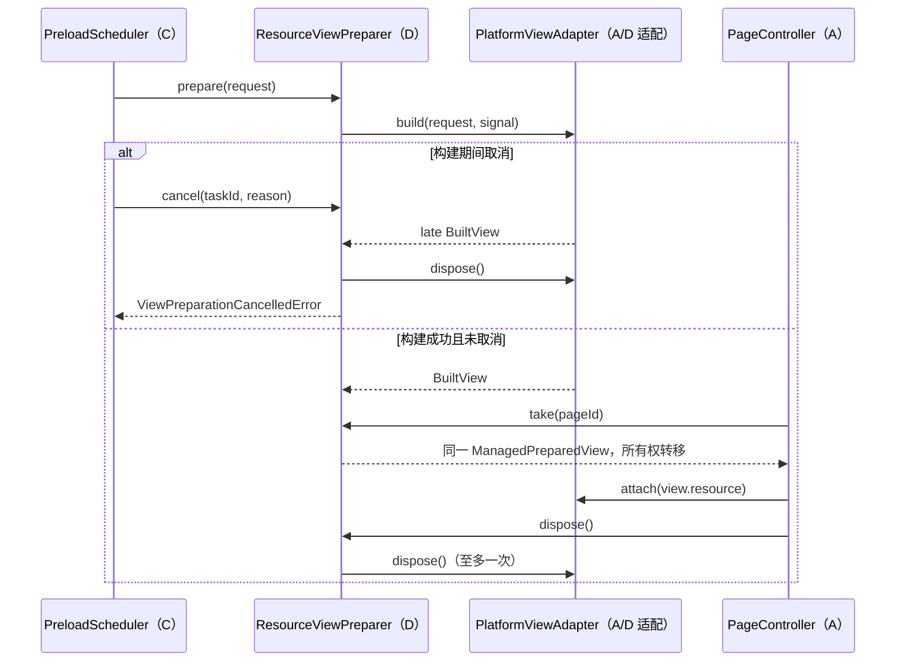

# D 模块：预渲染与资源管理

本模块实现 `ViewPreparer` / `PreparedView` 的主机侧资源生命周期：由适配器构建视图，D 管理待完成构建、可复用缓存、命中后的所有权、预测落空、过期、容量和内存压力。公共 `src/contracts.ts` 未改动。当前验证是真实 TypeScript 对象及其释放回调，不是 OpenHarmony ArkUI 真机预渲染结果；平台构建器和设备验收仍由 A 接入后完成。

## 要求对照

| D 的第一轮要求 | 实现 | 自动验收 |
| --- | --- | --- |
| 视图预构建 | `ResourceViewPreparer` 调用注入的 `ViewBuilder`，构建成功才进入缓存 | 构建次数、对象身份、失败重试测试 |
| 一次真实视图复用 | `take(pageId)` 返回同一 `ManagedPreparedView`，其 `resource` 是构建器原对象；重复 `take` 不重复构建 | `a built view is reused by identity...` |
| 一次预测落空释放 | `releaseAll('prediction-miss')` 释放全部未取用缓存；新任务替代同页旧任务 | 预测落空、同页替代测试 |
| 取消后晚到资源也释放 | 取消信号与完成回调共同检查；晚到结果先 `dispose()` 再以取消错误拒绝 | 延迟 Promise 取消测试、旧任务晚到测试 |
| 失效释放 | TTL 到期在 `take()` 和 `releaseExpired()` 边界释放，不提供过期视图 | 到期边界与选择性释放测试 |
| 内存压力回收 | `releaseAll('memory-pressure')` 取消待构建任务并释放缓存；容量超限时按优先级和 LRU 淘汰 | 内存压力、数量/字节容量测试 |

## 文件与源码锚点

| 文件 | 职责与固定符号 |
| --- | --- |
| `src/preparation/index.ts` | D 模块唯一导出入口 |
| `src/preparation/view-preparer.ts` | 构建适配、缓存和状态机；`src/preparation/view-preparer.ts:146#ResourceViewPreparer` |
| `src/preparation/view-preparer.ts` | 构建/重复任务/同页替代及晚到处理；`src/preparation/view-preparer.ts:173#prepare` |
| `src/preparation/view-preparer.ts` | 命中与所有权转移；`src/preparation/view-preparer.ts:243#take` |
| `src/preparation/view-preparer.ts` | 取消、过期、全量回收；`src/preparation/view-preparer.ts:258#cancel`、`src/preparation/view-preparer.ts:272#releaseExpired`、`src/preparation/view-preparer.ts:284#releaseAll` |
| `src/preparation/view-preparer.ts` | 优先级/LRU/字节容量淘汰；`src/preparation/view-preparer.ts:354#enforceCapacity` |
| `tests/preparation.test.mjs` | 15 项模块行为、负路径和竞态回归测试 |

## 接口与所有权

```javascript
import { ResourceViewPreparer } from './dist/preparation/index.js';

const preparer = new ResourceViewPreparer(async (request, { signal }) => {
  const nativeView = await platformBuilder(request.pageId); // A 提供真实 ArkUI 适配器
  if (signal.cancelled) nativeView.dispose();
  return {
    resource: nativeView,
    estimatedBytes: platformEstimate(nativeView),
    dispose: () => nativeView.dispose(),
  };
}, { maxPreparedViews: 4, maxPreparedBytes: 32 * 1024 * 1024, ttlMs: 60_000 });

await preparer.prepare({ taskId: 'prediction-42', pageId: 'detail', priority: 1 });
const view = preparer.take('detail');
if (view !== undefined) {
  attach(view.resource); // 这里得到的是构建器返回的同一视图对象
  view.dispose();        // 前台使用完毕，由调用方释放
}
```

- `ViewBuilder<T>` 是 D 与平台的唯一适配点。`resource` 是真实平台视图句柄，`estimatedBytes` 是适配器提供的缓存记账估计，`dispose()` 执行平台资源释放；D 不把数据对象冒充 ArkUI 视图。
- `prepare()` 对同一未决 task 返回同一 Promise，对同一缓存 task 返回同一视图。同一 page 的新 task 会以 `prediction-miss` 取消旧 task，防止同页多个候选失去归属。
- `take()` 成功即把所有权转给调用方。之后 `cancel()`、`releaseAll()` 和容量淘汰都不会释放该前台视图；调用方必须最终调用 `dispose()`。未命中或仍在构建时返回 `undefined`。
- `ManagedPreparedView.dispose()` 幂等，底层释放回调至多执行一次。已释放视图再读取 `resource` 会抛错，避免 use-after-free。
- `cancel(taskId, reason)` 是具体类提供的 C→D 接口，未修改共享 `ViewPreparer`。取消未知任务是无操作；取消已 `take()` 的任务不会干预前台所有权。
- 待构建任务取消后，Promise 以 `ViewPreparationCancelledError` 拒绝，调用方应 `await/catch`。构建器可在每个异步边界检查 `signal.cancelled` 主动停止；即使它完全忽略信号，D 也会释放晚到资源。
- `releaseAll()` 会尽力处理全部任务；一个释放失败不阻止其他释放，最后以 `AggregateError` 报告，不静默吞错。`getStats()` 提供缓存、待构建、释放、晚到释放、过期和淘汰计数。

## 回收策略

缓存数量、估算字节和 TTL 默认值集中在 `DEFAULT_VIEW_PREPARER_OPTIONS`：4 个视图、32 MiB、60 秒。它们是待设备实测调整的开发默认值，不是课程指标，也不是真实堆内存测量。生产时钟应注入平台单调时钟，不能混用不同会话或不单调的墙上时间。

容量超限时，D 先淘汰数值优先级较低者；优先级相同淘汰最久未使用者，再按 taskId 确定顺序。较大 `priority` 表示更重要，这是 D 对现有数值字段的明确解释，A/C 接入时必须一致。单个视图超过总字节预算时直接释放并抛出 `ViewCapacityError`，不会为了塞进新视图而清空全部有效缓存。

`releaseAll('memory-pressure')` 是系统内存告警的统一入口；普通容量约束自动淘汰，严重压力由 A/C 调用全量回收。已 `take()` 的前台资源不参与抢占，避免为了回收预渲染缓存破坏当前页面。



## 验证与平台边界

`tests/preparation.test.mjs` 覆盖对象身份复用、重复释放、预测落空、取消前/后、晚到资源、TTL 等值边界、优先级/LRU、字节预算、超大资源、同页替代竞态、内存压力、前台所有权、重复任务、构建失败重试、聚合释放异常和非法输入。主机测试中的 `BuiltView` 是有真实构建计数和释放回调的测试适配器，用来证明 D 的所有权与竞态逻辑；它不宣称 ArkUI 构建、布局、绘制或设备内存已经验证。

2026-11-05 使用 Windows / Node.js 22.21.1 / TypeScript 5.9.3 运行完整 `scripts/pipeline.mjs`：环境检查、严格类型检查、干净编译、82 项单元测试、合成回放、路径/事件策略对照和参数批量对照全部通过；其中 D 新增 15 项。报告为 `artifacts/pipeline/2026-11-05T10-42-02-333Z-5ed7c9d1/report.json`，该目录按仓库规则不提交 Git。D 源码规范扫描为 0 错误、0 警告。环境检查未发现 `hdc`、`ohpm`、`hvigorw`，报告中的目标环境验证为 `not-run`。

A 接入时仍需在选定 OpenHarmony SDK/API 和设备/模拟器上验证：真实视图预构建是否包含布局与绘制、复用后页面状态是否正确、取消是否终止平台工作、内存告警如何到达、前台帧耗时与内存是否改善。只有这些平台检查完成后，才能把本模块称为真机预渲染闭环。

## 与 C 分支合并后的兼容说明

2026-11-06 合并 C 时，共享 `CancelReason` 已增加 disabled、cleared、session-ended、superseded。D 的运行时校验同步接受这些原因，未知原因仍拒绝；独立交付时的源码锚点行号保持不变。上面的 82 项结果是 D 独立交付的历史记录，合并后的完整结果见 [C 模块验证记录](preload.md)。

C 的 `DataViewPreparer.prepare(request, data)` 与本模块的 `prepare(request)` 需要适配，不能直接互换。接入 C 的路径须在准备成功后立即调用 D.take(pageId) 交出缓存所有权，再把视图返回 C；前台通过 C.take(taskId) 接管数据和视图。取消超时在适配层映射为 expired，C 保留其 failed/timeout 状态。`tests/preload-preparation.test.mjs` 对真实 D 管理器及测试构建器验证这条交接路径，包括全部八种取消原因、超时、晚到资源和前台保护；这不是已交付的 ArkUI 平台适配器。

视图移交 C 后不再计入 D 缓存预算，A/C/D 仍须确定这些视图的总量、字节和生命周期预算，不能用 D 的缓存统计代替全量资源测量。
