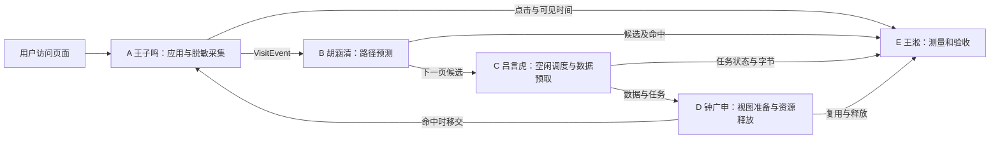

# P07 项目五人分工与当前进度说明

依据用户提供的分工表、仓库现有源码和 2026-11-09 的本机复现结果整理。本文供组内沟通和答辩讲解；“第一轮要求”来自分工表，“当前状态”以仓库实际实现与验证为准。负责人姓名按分工表记录，具体代码的最终归属仍以团队提交记录为准。

## 先用一句话理解项目

项目希望利用用户**已经发生**的页面访问，预测下一页；在合适的空闲时机提前准备数据和视图。用户真的打开该页时复用准备好的资源；预测落空、取消或资源紧张时及时释放。最后用同口径的原始数据比较等待时间、命中率和资源开销。

页面再次打开时，A 先核对 C 上一轮准备的目标是否与实际页面一致；命中就接管，落空就取消。E 在旁边记录，不应为测量而让 B 再学习一次事件。

## 总览

| 负责人 | 分工 | 主要回答的问题 | 第一轮要求 | 当前可确认的状态 |
| --- | --- | --- | --- | --- |
| 王子鸣 | A 应用与集成 | “谁访问了哪个**页面类型**？应用如何把模块接起来？” | 应用可运行；脱敏、可关闭的页面事件；同会话事件进入预测器；组织接口评审 | 浏览器 A/B/C 演示可交互；OpenHarmony A/B/C HAP 已编译打包。采集、关闭、清除和接入有主机测试；HAP 未签名，设备运行未验证 |
| 胡涵清 | B 路径预测 | “下一页最可能是什么？证据不足时是否放弃预测？” | 可调用的预测模块、冷启动/异常输入规则、可复现离线结果 | 有界一阶模型、会话接入、配置和离线回放已实现并进入主机流水线；核心代码已随 A 工程通过 ArkTS 编译，设备行为未验证 |
| 吕言虎 | C 调度与数据预取 | “何时、按什么优先级提前取数据？怎样取消？” | 一次完成、一次取消、一次失败；任务状态可追踪 | 调度器、控制器、状态快照和主机 HTTP 场景已实现；A 的鸿蒙工程同步并编译了 C 核心，但演示仅用固定内存数据和手动空闲信号，真实 SDK 网络/空闲适配未验证 |
| 钟广申 | D 预渲染与资源管理 | “视图能否复用？落空或取消后谁释放？” | 一次视图复用、一次落空释放、取消后晚到资源释放 | 主机侧 `ResourceViewPreparer` 与生命周期测试已实现；C/D 主机交接测试通过。真实 ArkUI 视图构建、复用和设备资源回收未验证 |
| 王淞 | E 流水线与评测 | “效果和代价怎样被公平记录与复核？” | 统一指标、保存真实原始数据、汇总结果和证据 | 测量模块、受控合成场景、主机流水线和 CI 配置已实现；最新本机流水线 147 项测试通过。真实设备原始数据和性能结论尚无 |

## A：应用与集成（王子鸣，你负责）

**通俗理解：**A 是项目的入口和总装。用户在演示页面切换时，A 只记录 `home`、`detail` 等固定页面别名，不把网址、账号或内容 ID 交给算法。采集默认关闭；用户启用后才生成本次运行的匿名会话。A 把同一会话的每次访问**只送 B 一次**，再把 B 的候选交给 C。关闭、清除、页面隐藏或恢复时，A 负责通知上下游切断旧路径和取消后台任务。

- **输入：**页面切换、采集开关、清除操作、平台单调时钟，以及后续平台提供的空闲/前台忙/内存压力状态。
- **输出：**脱敏 `VisitEvent`、B 的下一页候选展示、C 的任务触发或取消、命中后交给页面的数据。
- **主要位置：**[`src/application/visit-collector.ts`](../src/application/visit-collector.ts)、[`src/application/visit-integration.ts`](../src/application/visit-integration.ts)、[`demo/`](../demo/)、[`harmony-app/`](../harmony-app/)。接口交接记录见 [`A-integration-review.md`](A-integration-review.md)。
- **已验证：**默认关闭、同会话连续访问、关闭/恢复、清除、非法页面拒绝、A→B→C 的主机测试；浏览器演示可点击；ArkTS HAP 构建成功。
- **边界：**当前鸿蒙页面的 C 演示用固定内存数据，空闲由按钮手动模拟；没有设备安装运行记录，也没有真实网络预取或 D 的原生视图复用。接口评审文档已准备，其他成员尚需确认。

## B：路径预测（胡涵清）

**通俗理解：**B 根据过去的页面转移做“下一页猜测”。如果过去从首页进入详情页较多，B 会把详情页列为候选；如果是首次访问、样本不足或页面不认识，B 可以返回空候选。B 只预测，不负责采集、下载或渲染。

- **输入：**A 已脱敏的 `VisitEvent`（匿名会话、固定页面别名、会话内单调时间）。
- **输出：**`SessionDecision`，包含访问边界、已发生的上一跳转移及下一页候选；候选分数是历史条件频率，不是一定命中的概率保证。
- **主要位置：**[`src/prediction/`](../src/prediction/)，核心为 `MarkovPredictor` 和 `SessionPredictor`；配置见 [`config/prediction.json`](../config/prediction.json)，细节见 [`prediction.md`](prediction.md)。
- **已验证：**冷启动、窗口淘汰、会话隔离、乱序/异常输入、关闭/清除、离线回放和参数对照均有主机测试或脚本；A 的 ArkTS 构建已包含 B 核心。
- **交给下一位：**把按顺序的候选给 C；即使候选为空，C 仍要处理上一轮可能遗留的任务。B 不直接调用 `observe()` 以外的上层二次学习入口，A 对一次访问也不应同时调用 `accept()` 与 `acceptDetailed()`。

## C：调度与数据预取（吕言虎）

**通俗理解：**B 说“可能去详情页”，C 决定是否现在值得提前准备数据。它看空闲、前台是否忙、内存压力、优先级和容量；用户开始点击时应优先处理前台，预测落空或关闭时撤销后台工作。每个任务能查到排队、运行、就绪、已消费、取消或失败状态。

- **输入：**B 的候选、A 给的真实页面与内容键，以及平台提供的环境状态。
- **输出：**可追踪的预取任务、就绪数据、取消/失败原因；命中时通过 `take()` 把数据和可选视图整体交给前台。
- **主要位置：**[`src/preload/`](../src/preload/)，尤其 `DataPreloadScheduler` 和 `PredictionPreloadController`；接口和状态详见 [`preload.md`](preload.md)。
- **已验证：**主机侧有任务排序、取消、超时、容量和晚到清理测试；本地 HTTP 场景可验证请求完成、主动中止与失败；A/B/C 的 ArkTS 演示核心已编译。
- **交给 D/A：**C 向 D 借用数据来准备视图；取消后要等异步结果最终结束并清理。若前台 `take()` 成功，A 持有整个资源包并在使用完毕后释放。
- **边界：**当前鸿蒙演示没有接真实网络请求，也没有系统空闲信号；手动按钮不能当成平台能力验收。

## D：预渲染与资源管理（钟广申）

**通俗理解：**C 提前取回数据后，D 负责提前建立可复用的“视图资源”，并管理这些资源的寿命。命中时把**同一个**已准备视图交给页面；落空、过期、容量满、内存紧张时释放；即使取消后视图才构建完成，也必须释放晚到资源。

- **输入：**C 的准备请求和数据、平台视图构建器、取消与内存压力通知。
- **输出：**`PreparedView`、复用或释放结果，以及缓存/释放统计。
- **主要位置：**[`src/preparation/`](../src/preparation/)，核心为 `ResourceViewPreparer`、`ManagedPreparedView`；细节见 [`preparation.md`](preparation.md)。
- **已验证：**主机测试检查对象身份复用、预测落空释放、TTL/容量淘汰、内存压力、取消竞态和晚到释放；C/D 交接测试检查数据与视图的所有权。
- **边界：**这些是 TypeScript 对象和释放回调的验证。真正的 ArkUI 视图创建、绘制、命中复用及设备内存回收仍需平台适配，不能把主机对象测试叫做真机预渲染。

## E：流水线与评测（王淞）

**通俗理解：**E 负责让“快了多少、浪费多少”有可复核的证据。它为每次点击记录预测候选、实际页面、任务状态、点击到可见时间和资源字节，再用统一公式计算覆盖率、命中率、耗时分位数及资源浪费。E 同时维护自动测试和 CI，让各人修改能被统一检查。

- **输入：**A 的点击/可见时间与脱敏事件、B 的候选、C 的任务状态和字节、D 的视图复用与释放统计。
- **输出：**`MeasurementSink` 记录、JSONL 原始数据、汇总报告、基线/优化对照和自动化检查结果。
- **主要位置：**[`src/measurement/`](../src/measurement/)、[`tests/`](../tests/)、[`benchmarks/`](../benchmarks/)、[`.github/workflows/host-pipeline.yml`](../.github/workflows/host-pipeline.yml)，指标口径见 [`measurement.md`](measurement.md)，验收表见 [`acceptance.md`](acceptance.md)。
- **已验证：**主机合成场景、指标校验、JSONL 往返、B/C/D/E 联合回放、Windows/Ubuntu CI 配置；本机完整流水线 147 项测试通过。
- **边界：**合成场景的毫秒数是测试参数，不是设备加速结果。真实设备数据、同环境基线对照与最终性能结论尚未完成；原始测量要注明来源和系统版本。

## 组内交接时要对齐的五件事

1. **页面和内容标识：**A/B/C 使用固定 `pageId`；动态内容还需要可预测且脱敏的 `dataKey`，不能把 URL、账号或令牌直接当标识。
2. **调用顺序：**A 对一次访问只向 B 投递一次；前台开始先通知 C，命中检查先于新候选任务；E 只旁路记录。
3. **取消与所有权：**C 负责取消任务，D 负责释放自己创建的视图；前台成功接管后由 A 页面调用资源包的 `dispose()`。
4. **统一时钟和指标：**访问顺序用会话内单调时间；点击到可见、任务状态等跨模块测量须在同一进程时钟口径下关联，不能拼接不同来源的时间。
5. **证据等级：**主机测试证明逻辑，ArkTS 构建证明可编译，设备录屏和原始数据才能证明目标平台运行与性能。当前可交付前两类；设备类尚待团队补齐。

## 本机复现与现阶段提交

在仓库根目录运行 `npm ci`、`npm run pipeline`、`npm run demo`、`npm run build:harmony`。2026-11-09 本机记录为：完整主机流水线 147 项测试通过；浏览器演示可交互；A/B/C OpenHarmony HAP 构建成功但未签名、未安装。详细命令与产物见 [`reproduction.md`](reproduction.md)，A 的本轮改动见 [`A-modification-report.md`](A-modification-report.md)，最终材料目录见 [`submission/README.md`](../submission/README.md)。用户已明确现阶段无需一定在模拟器上运行；设备验证因此不作为本轮复现前置条件，但不能标为已完成。
